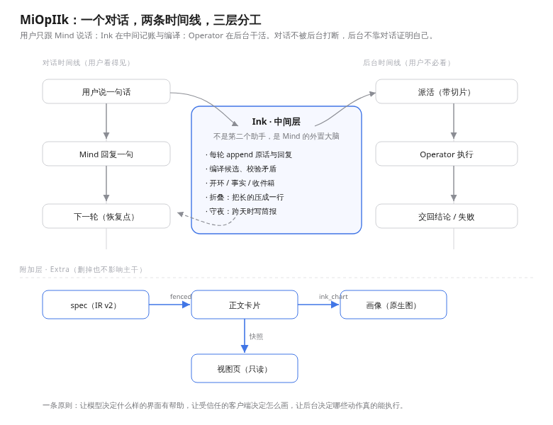

# MiOpIIk


[](https://github.com/deepseek-ai/deepseek-harness)

**Mind · Ink · Operator** —— 让持续对话与异步行动各自独立，又能自然咬合的 Agent 架构。

`MiOpIIk` 取自 `Mi`(nd) + `Op`(erator) + `IIk`(ink)。把 Ink 藏在词尾，是因为它本来就是隐在中间的那一层。



## 它是什么

常规的「对话助手 + 工具调用」一旦遇上长耗时或跨回合的工作，往往只能二选一：要么阻塞当前对话让用户干等，要么把任务丢去后台从此失联；要是再引入一个中间管事的角色直接对用户开口，又很容易抢话、编造结论，跟主对话打架。

MiOpIIk 的做法是把「对话、记账、干活」拆成三层，并且**只给一层发言权**：

- **Mind（对话主干）**：唯一面向用户的角色。负责讨论、权衡、做决定、推进叙事；所有悬而未决的事（开环）只由它亲手闭合，对外提交的改动也由它向用户发起提议。
- **Ink（中间层）**：退在幕后的外置记忆与编译器。每轮过后，它把原话与回复收进上下文，从中提炼候选结论与未闭开环，维护 T0–T3 分层收件箱，盯着后台任务有没有超时卡死，并在话题切换或跨天时做折叠与简报素材整理。它永不直接对用户开口，也不替对话做决定。
- **Operator（后台执行）**：纯粹的行动层。它不拿整段冗长的聊天记录，只接手切好的「鱼骨分支切片」（分叉前提、原话引用、依赖事实卡）和一份带验收样例的完整契约；干完之后通过 `ink_report` 把结论或失败原因交回，不在对话里露面。

于是系统里同时流动着两条时间线：前台对话是一串连续的 turn 序列，后台执行是一串异步的 job 序列，由中间的 Ink 负责把两边的账对齐。**对话不被后台打断，后台也不必借对话证明自己。**

## 现在能做什么

- **对话主干与记忆治理**：
  - **开环（Loops）**：不是带日期和指派人的待办表，而是对话里悬着的话（未答之问、待选方案、口头承诺、半成形意图等）。随对话顺手登记，随话题演进自然老化或唤醒；Ink 只能提示「这条看起来被答了」，闭合权始终在 Mind 手里。
  - **事实卡（Facts）**：已经敲定的结论，每张都带着原文出处（provenance）与失效条件，后续需要自答时必须凭卡引用，无引用即上报，杜绝临场编造。
  - **鱼骨分支（Branches）**：一件事从对话哪一句长出来，就在哪一轮分叉出一条 `B-n` 分支，挂上前提、原句引用和依赖事实；Operator 沿着分支干活，结束后再把结论汇回主干。
  - **草稿与提交门（Draft & Commit）**：吃不准的半成品先留在草稿区自然老化；真正对外生效的改动走唯一的 `ink_commit` 闸门，用户只需回答「行」或「不行」，被拒后由系统自行收拾，绝不反问用户「你想怎么改」。

- **全量可回放账本**：
  所有状态一律落为工作区下的 append-only JSONL，不靠上下文硬记，随时可以重建或回放：

  | 账本文件 | 记录内容 | 写入方 | 读取方 |
  |---|---|---|---|
  | `ink-context.jsonl` | 每轮原话、回复与判断（保留尾部 24 条，超出折入 2000 字头部） | Ink | 回合后编译、所见面板 |
  | `facts.jsonl` | 已敲定的结论、出处指针与失效条件 | Mind（经 `ink_facts`） | 每轮 L3 注入、自答校验 |
  | `loops.jsonl` | 对话中悬而未决的开环及其闭合条件 | Mind（经 `ink_loops`） | 每轮 L3 注入、收件箱关联 |
  | `inbox.jsonl` | 待 Mind 过目的后台进展与编译预览（分未读 / 历史 / 星标） | Ink | 每轮按预算注入 L3 |
  | `jobs.jsonl` / `taskboard` | 后台派发契约、认领状态、执行进度与结算回执 | Ink / Operator | 守夜巡检、所见面板 |
  | `widgets.jsonl` | Extra 展示层渲染过的结构化 `view spec` 快照 | `ink_view` | 视图页归档 |

- **编译线**：
  每轮对话结束后，Ink 自动扫描近段上下文、活跃开环与事实卡，提炼出带原话引用（`U-n`）的候选结论与候选开环，压成一行预览放进收件箱；当 Operator 交回的实测结果与早先对话里说过的旧话相抵触时，编译线会把矛盾直接指认到具体哪一句话，交由 Mind 挑合适的时机向用户坦白更正。

- **后台派发与守夜**：
  派发前强制做「可验收性自检」——说不清一句话目标、给不出完成样例就不派发，宁可继续聊。契约齐备后拉起子 agent 执行，由 `ink_report` 交回产物或失败原因并在任务板结算；长时间无进展或超时的任务会被守夜机制捕获，生成 `[阻塞]` 预览送入 T0 收件箱。

- **两阶段折叠与跨天交接**：
  折叠不靠字数硬截断，而是由事件驱动（话题切换、收工告别、跨天重开）。先由 Ink 做一份影子折叠，再交由仍握着旧上下文的 Mind 逐条核对「每条活跃开环折完之后还接不接得上」，验收通过才原子替换。隔夜收工时由 Mind 亲手写下五段式交接简报（推进、开环、在跑、草稿、下步打算）；若前一天没打招呼就断了线，第二天开工时会先承认上次断在哪里，再往下接话。

- **所见（透明后台）**：
  虽然 Ink 不对用户说话，但它看到的一切都可以摊开备查：当前 `ink-context` 的折叠头部与活跃尾部、刚编译出的候选、待读收件箱、以及后台任务板的实时状态。

- **Extra 展示层（整层可删）**：
  当纯文字不方便让人一眼看清对比、结构或趋势时，用同一份受限的 `view spec`（7 种白名单形状 + 4 种预设样式）落向四处——正文内嵌卡片、回合末独立行、侧栏「视图」页快照、或由 Host 直接渲染成 SVG 落盘并以原生 Markdown 图片引用的「画像」。协议 v2 自带容量预算、数据出处（`source` / `note`）、动作安全分级与必填的 `fallback` 纯文本兜底。

## 仓库结构

| 路径 | 内容 |
|---|---|
| `miopiik-dsh/` | MiOpIIk Agent：Ink 账本、Operator、编译与后台视图，不再提供 IUI 客户端注册或旧展示工具 |
| `miopiik-iui/` | **独立 DSH IUI 插件**：声明式协议、React 渲染器、Markdown 扩展和打包工具 |
| `test/` | 单元测试套件（`node --test test/`） |
| `docs/` | 设计文档、实机验证记录、图文技术报告、架构示意图 |
| `SPEC.md` | 架构规格单一真源（十二不变式、数据模型、折叠与治理机制） |
| `tools/` | 维护与辅助脚本 |

Extra 展示层的早期设计归档在 [`miopiik-extra`](https://github.com/Chillizu/miopiik-extra)；新的 **MiOpIIk IUI** 已提取到本仓 `miopiik-iui/`，可作为独立 DSH bundle 安装。旧 `ink_view`、`ink_chart` 已停止注册，历史账本不删除。安装与已知限制见 [IUI 插件说明](miopiik-iui/README.md)。

## 安装（DSH workspace bundle）

在对应 profile 的 `cordis.patch.yml` 中挂入插件：

```yaml
# ~/.dsh/profiles/<profile>/cordis.patch.yml
- insert:
    - id: miopiik-dsh
      name: 'miopiik-dsh'
```

将本仓库以软链放进该 profile 的 `plugins` 目录即可；插件目录自身已带好 `cordis.patch.yml`（`miopiik-dsh/cordis.patch.yml`）。

## 设计原则

1. **中间层不发言**：Ink 的一切产物先落账本、进收件箱；说与不说、什么时候说、用什么语气说，全部由 Mind 决定。
2. **后台可失败**：失败也是合法结果，必须通过交回语义体面收场；宁可明确报废并记入判例，也不让任务在后台悄悄蒸发。
3. **展示可删**：Extra 展示层与核心账本完全解耦，随时可以整层拆走；拿掉之后，对话主干与后台协作照常运转。
4. **不把 UI 当审批**：屏幕上画了按钮不代表用户已经授权；卡片上的动作先只做渲染与分级提示，真正改变外部状态的写入仍要回到带权限与审计的通道。
5. **账本先于对话**：真相留在磁盘上的 append-only 日志里，上下文只是按缓存前缀排布（L0–L5）的一份工作索引。

## 文档

- [SPEC.md](SPEC.md) —— 规格（单一真源）
- [docs/REPORT-2026-11-10.md](docs/REPORT-2026-11-10.md) —— 技术与理念报告（图文）
- [docs/EXTRA-UI.md](docs/EXTRA-UI.md) —— Extra 展示层：协议、落点、对齐说明
- [docs/IUI-V1-RELEASE-CANDIDATE.md](docs/IUI-V1-RELEASE-CANDIDATE.md) —— IUI v1 稳定候选：已验收能力、上线门禁、未完事项与回滚
- [docs/IUI-NATURAL-OUTPUT-AUDIT.md](docs/IUI-NATURAL-OUTPUT-AUDIT.md) —— 两条真实测试会话的失败模式、模型开销与自然输出打磨记录
- [docs/ALIGNMENT-AUDIT.md](docs/ALIGNMENT-AUDIT.md) —— 自审计与偏差登记
- [docs/machine-test-2026-11-06.md](docs/machine-test-2026-11-06.md) —— 实机验证记录

## 状态

`v0.1.x`（当前 `v0.1.3`）—— 可直接安装使用，对话编译线、后台派发与交回、跨天简报、所见面板与 Extra 四个落点均已实机跑通；尚未发布到 npm，接口与账本格式仍在演进中。

## License

MIT
