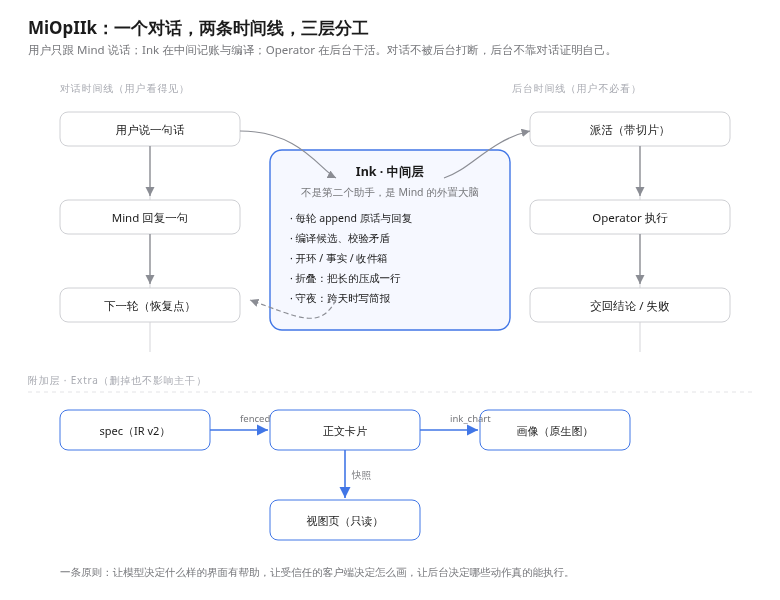

# MiOpIIk Agent


**Version 0.1.1**（stable） | [English](README.md) | 简体中文

`MiOpIIk` = `Mi`(nd) + `Op`(erator) + `IIk`(ink)。

`miopiik-dsh` 是 [DeepSeek Harness](https://github.com/deepseek-ai/deepseek-harness)（DSH）的 host 侧插件。它把 DSH Web 会话组织为三层结构：前台对话主干（`Mind`）、中间层账本与编译器（`Ink`）、后台执行层（`Operator`）。插件提供系统章程、受限工具面、append-only JSONL 账本、后台派发与界面 projection。

**当前发布：** 0.1.1（stable）。请从 GitHub Release tarball、本地 `npm pack` 或本地 checkout 路径安装；本包未发布到 npm registry。

## 它是什么

常规单回路「对话助手 + 工具调用」在处理长耗时或跨回合任务时，往往要么阻塞前台对话，要么把任务放到后台后失去上下文同步；若让中间协调层直接向用户发言，则会与主对话产生竞争和未验证结论。

MiOpIIk 将对话、记账与执行拆为三层，并把面向用户的发言权限定在单一角色：

- **Mind** 是对话主干与唯一面向用户的角色，负责讨论、权衡、拍板、闭合悬而未决的开环，并通过提交门发起对外改动提议。
- **Ink** 是幕后的外置记忆与编译器。每轮结束后，它记录用户输入与助手最终回复，提炼候选结论与开环，维护分层收件箱，巡检后台任务的超时与无进展状态，并在话题切换或跨天时准备折叠与交接素材。它不对用户发言，也不替对话做决定。
- **Operator** 是执行层，只接收六要素契约与鱼骨切片（分叉前提、原话引用、依赖事实卡），不接收聊天记录。完成后通过 `ink_report` 交回结论或失败原因，不在对话流中露面。

系统内并行推进两条时间线：前台是连续的对话 turn 序列，后台是异步的 job 序列，由 Ink 在工作区账本中对齐两侧状态。



上图中，上方为本 Agent；下方「附加层：Extra」已退役，其设计史保存在 IUI 仓库的 [docs/EXTRA-UI.md](https://github.com/Chillizu/miopiik-iui/blob/main/docs/EXTRA-UI.md)，当前展示能力由独立的 MiOpIIk IUI 插件提供。

## MiOpIIk Agent 与 MiOpIIk IUI

两个插件是彼此独立的包，可单独安装，互不依赖。

| | MiOpIIk Agent（`miopiik-dsh`） | MiOpIIk IUI（`miopiik-iui`） |
|---|---|---|
| 定位 | host 侧 agent：Mind / Ink / Operator | 纯表现层 |
| 当前版本 | 0.1.1（stable） | 0.1.0-rc.4（prerelease） |
| 仓库 | https://github.com/Chillizu/miopiik | https://github.com/Chillizu/miopiik-iui |
| 依赖另一个插件 | 否 | 否 |
| 可单独安装 | 是 | 是 |
| 渲染什么 | 提供工具、prompt 上下文、会话功能页与右栏面板；不渲染聊天消息 | Markdown 中的声明式 `iui` 块与行内 token，由浏览器侧渲染 |
| 写入哪里 | 工作区下的 append-only JSONL 账本 | 仅在浏览器 `localStorage` 存一个渲染偏好；不写日志 |
| 宿主要求 | DSH Web（web profile） | DSH Web（web profile）；聊天内联渲染另需实验性 chat 包补丁 |

**Agent 提供 Mind / Ink / Operator 运行时与后台面板，IUI 提供可选的声明式界面展示。** 单独安装 Agent 即可获得完整的三层治理与账本机制；需要用徽章、图表、表格或本地状态切换呈现数据时，再安装 IUI。

早期的 Extra 展示层已退役（见 [docs/EXTRA-UI.md](https://github.com/Chillizu/miopiik-iui/blob/main/docs/EXTRA-UI.md)）。账本中已有的 `ink-view` widget 快照保持可读，可由 IUI 的只读 legacy adapter 回放；当前 Agent 不再写入新的 widget 记录。

## 架构与数据流

服务端实现在 `host/`，浏览器侧在 `client.js`，插件入口在 `index.js`。

单个 turn 按以下七步流转：

1. **观测。** 回合结束时，Ink 将用户真人提示与助手最终消息追加写入 `observations.jsonl`，不记录推理思维链。
2. **编译。** `conversationCompile` 开启时，Ink 读取自身的中间层上下文与近期原话，生成候选 note：一行结论、一个用户可回答的问题、置信度、证据及矛盾标记。
3. **投递。** note 进入分层收件箱成为预览（T0 阻塞、T1 关联活跃开环或分支、T2 新结论、T3 其余）。是否在对话中提及、何时提及由 Mind 决定。
4. **行动。** Mind 通过 `ink_*` 工具更新账本：登记或闭合开环、写入带出处的事实卡、开启鱼骨分支、保存草稿，或通过提交门发起对外提案。
5. **派发。** `ink_dispatch` 校验六要素契约，创建 `pending-dispatch` 开环与后台 job，挂载分支切片，并启动只携带契约与切片的 Operator 子 agent。
6. **交回。** Operator 通过 `ink_report` 交回带证据的结论（落为事实卡）或通过最终报告返回。Ink 将报告编译为收件箱预览，若有矛盾则标注具体的 `U-n` 原话编号。守夜机制将无进展或超时任务转为 T0 阻塞预览。
7. **折叠与交接。** 话题切换推进 epoch；长上下文按两阶段折叠；每日收工由 Mind 撰写五段式简报。检测到隔夜硬断点时，次日开工先在 L3 呈现断点位置再继续。

每轮的 prompt 上下文（L3）由活跃开环与收件箱预览装配并注入系统提示词，不作为 user 或 assistant 消息写入聊天流。

### 账本布局

所有状态均为工作区下的 append-only JSONL，文件名定义见 `host/store.js` 的 `LOG_NAMES`。

```
<workspace>/.dsh/miopiik/
  sessions/<sessionId>/
    observations.jsonl    facts.jsonl        loops.jsonl
    notes.jsonl           inbox.jsonl        jobs.jsonl
    drafts.jsonl          cases.jsonl        branches.jsonl
    folds.jsonl           briefings.jsonl    details.jsonl
    ink-context.jsonl     ink-debug.jsonl    widgets.jsonl
    details/<hash>.txt
  shared/
    facts.jsonl
```

| 账本文件 | 记录内容 | 写入方 | 读取方 |
|---|---|---|---|
| `observations.jsonl` | 逐回合观测：用户真人提示、助手最终消息、回合边界、折叠 | Ink | 编译、折叠、所见面板 |
| `notes.jsonl` | 决定账与编译出的候选 note | Ink | 收件箱投递、审计视图 |
| `loops.jsonl` | 开环操作：`create` / `touch` / `status` / `close` / `drop` | Mind（经 `ink_loops`）；用户干预命令 | L3 上下文、收件箱关联 |
| `facts.jsonl` | 事实卡操作：`add` / `revise` / `invalidate`，带出处与作用域 | Mind（经 `ink_facts`）；Operator（经 `ink_report`） | L3 上下文、自答校验 |
| `inbox.jsonl` | 已投递预览及其状态：`read` / `star` / `unstar` / `defer` / `supersede` | Ink | L3 上下文、所见面板 |
| `jobs.jsonl` | 后台派发契约、子会话 id、任务状态与停止原因 | Ink / Operator 层 | 守夜巡检、任务板、所见面板 |
| `drafts.jsonl` | 提交门之下的草稿，含过期 | Mind（经 `ink_draft`） | 提交门、所见面板 |
| `cases.jsonl` | 判例：问题、答案、引用 | Ink | `ink_ask` 引用路径 |
| `branches.jsonl` | 鱼骨分支：前提、原话引用、依赖事实、汇回结论 | Mind（经 `ink_branch`） | 派发切片、所见面板 |
| `folds.jsonl` | 两阶段折叠提案、验收结果、应用记录 | Ink | 折叠验收、所见面板 |
| `briefings.jsonl` | 跨天交接简报与硬断点记录 | Mind（经 `ink_brief`） | 次日 L3、所见面板 |
| `details.jsonl` | 详情索引：内容 hash、实体、挂在开环/分支/job 上的指针 | Ink | `ink_recall` |
| `ink-context.jsonl` | Ink 自己的中间层上下文：尾部条目与头部折叠 | Ink | 编译 |
| `ink-debug.jsonl` | 留作审计的调试记录 | Ink | 诊断 |
| `widgets.jsonl` | 已退役 Extra 层写入的历史展示 spec；只读回放 | （仅历史数据） | IUI 的 legacy adapter |
| `shared/facts.jsonl` | 同一工作区所有会话共享的 workspace 级事实 | Mind（`ink_facts` 传 `scope: "workspace"`） | 所有会话 |
| `details/<hash>.txt` | 按内容 hash 寻址的详情正文 | Ink | 带 hash 的 `ink_recall` |

账本为纯文本 JSONL。会话打开时按顺序回放各文件；损坏行会被跳过，读时兼容转换不改写磁盘原文件。

### 工具面

模型工具面共 14 个：Mind 使用 12 个，Operator 使用 2 个。

| 工具 | 归属 | 用途 |
|---|---|---|
| `ink_status` | Mind | 读取后台状态：开环、事实、收件箱计数、epoch、day |
| `ink_loops` | Mind | 开环的 `list` / `get` / `add` / `touch` / `close` / `drop` |
| `ink_facts` | Mind | 事实卡的 `list` / `add` / `revise` / `invalidate` |
| `ink_inbox` | Mind | 收件箱的 `list` / `open` / `read` / `star` / `unstar` / `defer` |
| `ink_dispatch` | Mind | 把契约完备的工作交给后台 Operator |
| `ink_commit` | Mind | 打开唯一的对外提交门 |
| `ink_brief` | Mind | 跨天简报的 `materials` / `save` / `latest` |
| `ink_epoch` | Mind | 推进话题 epoch |
| `ink_draft` | Mind | 草稿的 `list` / `add` / `drop` |
| `ink_branch` | Mind | 鱼骨分支的 `list` / `open` / `get` / `summary` / `context` / `merge` / `abandon` |
| `ink_fold` | Mind | 上下文折叠的 `propose` / `review` / `approve` / `reject` / `list` |
| `ink_recall` | Mind | 检索详情索引；按 hash 读回一份详情 |
| `ink_ask` | Operator | 向 Ink 提问；Ink 只凭引用回答，否则上报 |
| `ink_report` | Operator | 交回一条带证据的结论，落成事实卡 |

工具边界在 `index.js` 中按角色强制隔离：Operator 子 agent 禁用 12 个 Mind 工具且不接收聊天历史，Mind 禁用 `ink_ask` 与 `ink_report`。用户也可在界面上通过 `/miopiik loop close L-1`、`/miopiik loop drop L-1`、`/miopiik fact invalidate F-1` 会话命令及对应按钮直接关闭开环或标废事实卡。

## 主要能力

- **开环管理。** 开环记录 Mind 与用户之间尚未收口的一句话：未答之问、等待用户、待选方案、口头承诺、待派发、半成形意图。开环不设截止日期与指派人，按天轴自然老化：`dormantAfterDays` 天未触碰转入休眠，`foldedAfterDays` 天后折成单行摘要，再次 touch 时唤醒。开环仅由 Mind 闭合或丢弃；Ink 只标记疑似已答的条目。`activeLoopCap` 控制进入 L3 的活跃数量。
- **带出处的事实卡。** 已确认的结论连同来源、置信度、有效期和作用域（默认 `session`，跨会话共享时用 `workspace`）写入账本。用户明确陈述的事实优先级高于 Operator 推断。Mind 依据记忆回答时引用事实卡或判例；无可用引用时触发上报。
- **鱼骨分支。** 分支（`B-n`）将一项工作锚定到它分叉出的对话轮次，记录分叉前提、主干原话引用和依赖事实 id。Operator 仅接收该分支切片。工作得出结论后，分支携带一行 claim 与证据汇回主干。
- **草稿区与唯一提交门。** 探索性或低置信产出先存入草稿区，满 `draftExpireDays` 天未更新则自动过期。对外变更统一经由 `ink_commit` 提案：提供一行标题与一句影响说明，由用户选择「行」或「不行」。低置信提案以及无真人输入的回合均在提交门处被拒绝；用户选「不行」即将草稿结算为 rejected。
- **编译线与矛盾指认。** 符合条件的回合结束后，Ink 从中间层上下文编译候选 note。当后台结果与此前 Mind 对用户的表述相冲突时，编译结果会标记矛盾并指向具体的 `U-n` 原话编号，交由 Mind 决定如何更正。
- **后台派发与守夜。** `ink_dispatch` 校验六项契约要素：目标、交付物、验收标准、验收样例、边界、预算；缺失任一要素即拒绝派发并列出缺项。`draft: true` 的探索派发仅需一句话目标，产出留在草稿区。任务运行期间，卡住守夜（`operatorStallMs` 内无新观测）与超时守夜（超过 `operatorTimeoutMs`）会各自投递 T0 阻塞预览，由 Mind 与用户决定后续处理。
- **两阶段折叠。** 折叠由事件触发。第一阶段由 Ink 生成影子折叠（含归档摘要与开环结算建议），不改写当前上下文；第二阶段由仍持有旧上下文的 Mind 按「折叠后所有活跃开环仍能续接」的标准验收。批准后，若宿主提供 compaction 服务则在下一回合边界执行替换；若无该服务则仅在 `folds.jsonl` 记账，保持原上下文不变。
- **跨天简报。** 每日收工时，Mind 基于 `ink_brief materials` 汇总的素材撰写五段式简报（推进、开环、在跑、草稿、下步打算）。次日开工时，L3 上下文加载最新简报及检测到的隔夜硬断点。
- **可视后台面板。** 会话功能页「MiOpIIk」包含鱼骨图、分支流水，以及活跃开环、事实卡、在跑任务、草稿与当日交接简报清单；「所见」页签展示 Ink 的折叠头部、活跃尾部与最新编译候选。右侧栏「Ink」面板展示开环计数、收件箱预览与近期决定。
- **插件页与设置页分离。** `插件 -> 已安装 -> MiOpIIk` 展示三层架构、职责、版本与账本路径说明。**设置 → 内置插件 → MiOpIIk Agent** 只读展示 Host 参数的内置默认值与可复制的 YAML 示例，实际运行值由当前 profile 配置决定。
- **append-only 账本与回放。** 会话状态持久化在工作区 JSONL 账本中，重启 DSH 后自动回放恢复。
- **历史兼容。** 已有会话账本不迁移、不删除。历史 `widgets.jsonl` 快照保持可读，可由独立的 IUI 插件只读回放；当前 Agent 不再写入新的 widget 条目。

## 示意用法

以下示例使用 `host/tools.js` 中的真实工具名与参数名，对话文本为示意。

### 1. 一条会改变后续判断的事实

**用户：**「这个仓库用 pnpm，别在这里跑 npm install。」

**Mind：** 调用 `ink_facts` 写入事实卡。

```json
{"action": "add", "claim": "This repository uses pnpm; do not run npm install here.", "provenance": ["user: turn 12"], "conf": "high", "source": "user", "scope": "session"}
```

**系统：** 将卡片追加到 `facts.jsonl`，并在后续回合的 L3 上下文中注入。若用户后续更改约定，Mind 对该卡执行 `revise` 或 `invalidate`。

### 2. 一条留在对话里的问题

**用户：**「设置页到底保留原始 YAML 示例，还是有个复制按钮就够了？」

**Mind：** 登记一条开环并继续当前讨论。

```json
{"action": "add", "text": "Decide whether the settings page keeps the raw YAML example or only the copy button", "type": "pending-option", "pointer": "turn 18", "closureCondition": "The user picks one and the page copy reflects it"}
```

**系统：** 在 `loops.jsonl` 追加一条 `create` 记录。后续回合用户给出决定后，Mind 按 id 闭合：

```json
{"action": "close", "id": "L-7", "reason": "user chose the copy button only"}
```

Ink 可提示该开环疑似已答，闭合操作由 Mind 执行。

### 3. 一份带真实契约的后台任务

**用户：**「把报告翻成英文，做完之前顺手把测试跑一遍。」

**Mind：** 先开启绑定到当前轮次的分支，再用完整六要素契约派发。

```json
{"action": "open", "label": "report-translation", "summary": "Deliver an English report and a green test run", "forkedAtTurn": 34, "premise": "The user wants the existing report translated and verified in one background pass", "quotes": ["Translate the report to English and run the test suite before you're done."], "facts": ["F-4"]}
```

```json
{"goal": "Translate the report to English and run the test suite", "deliverables": "An English report file plus the test run output", "acceptance": "The English report exists and the test suite exits 0", "acceptanceSample": "A short English report; a test summary with no failures", "boundary": "Do not change the report's conclusions or the source code", "branch": "report-translation", "budget": "One background pass, no network access"}
```

**系统：** 创建 `pending-dispatch` 开环、job 记录、任务板卡片，并启动仅携带契约与分支切片的 Operator 子 agent。执行完毕后，Operator 交回结论：

```json
{"claim": "The English report is complete and the test suite passes", "conf": "high", "evidence": "docs/report.en.md; test run exited 0"}
```

Ink 将结果编译为收件箱预览；Mind 用 `ink_inbox {"action": "open", "id": "I-6"}` 查看详情，用 `ink_branch {"action": "merge", "id": "B-3", "claim": "English report delivered; tests green", "detail": "docs/report.en.md"}` 汇回分支，再向用户同步结论。

### 4. 提交门与一天收工

**用户：**「把设置页文案缩短那版发出去，但发之前问我一声。」

**Mind：** 先存入草稿区，再调用 `ink_commit` 打开提交门。

```json
{"action": "add", "title": "Shorter settings page copy", "summary": "Replace the configuration page text with the shorter version", "artifact": "docs/draft/settings-copy.md", "conf": "mid"}
```

```json
{"title": "Settings page copy", "summary": "Shorter configuration text; no behavior change.", "confidence": "high", "draftId": "P-3"}
```

**系统：** 向用户发起单选提问（行 / 不行）。选「行」将草稿结算为 committed；选「不行」结算为 rejected。低置信提交会在提问前直接被门禁拒绝。

每日收工时由 Mind 保存交接简报：

```json
{"action": "save", "progress": "Settings copy shortened and shipped", "loops": "L-7 closed; L-9 still waiting on the release decision", "running": "No background jobs running", "drafts": "None", "next": "Start from the release decision, not from a summary of the day"}
```

**系统：** 将简报写入 `briefings.jsonl`，并在下一次会话的 L3 上下文与后台面板中展示。

## 运行要求与支持范围

| 项 | 要求 |
|---|---|
| 宿主 | DSH Web（`web` profile）；host 侧插件 |
| DSH 基线 | 0.2.1-rc.5（测试与发布检查针对的版本） |
| Node | >= 23.6（`package.json` 的 `engines`） |
| 运行时依赖 | 无（零第三方运行时依赖） |
| 浏览器侧 | `client.js`（`platform: "web"`）：接入会话视图、右侧栏、插件页（`plugins.bundle.config`）与设置页（`settings.plugins.tab`） |
| 其他平台 | 未验证；依赖 DSH Web 的 tools、system prompt、session projections、subagents、user questions、compaction 服务 |

完整兼容说明见 `docs/SUPPORT-MATRIX.md`。

## 安装、升级、卸载、回滚

**本包未发布到 npm registry。** 不带路径或 tarball 的 `dsh plugin add miopiik-dsh` 无法解析包名。请从 GitHub Release tarball、本地 `npm pack` 产物或本地 checkout 路径安装。

### 从 GitHub Release 安装（推荐）

1. 从
   https://github.com/Chillizu/miopiik/releases/tag/miopiik-agent-v0.1.1
   下载 `miopiik-dsh-0.1.1.tgz` 与 `SHA256SUMS.txt`。
2. 在下载目录执行 `sha256sum -c SHA256SUMS.txt` 校验。
3. 执行 `dsh plugin --profile <profile> add ./miopiik-dsh-0.1.1.tgz` 安装到目标 profile。
4. 重启提供该 profile 的 DSH 进程以加载 host 插件。

### 从本地 checkout 安装

仓库根即包根（`package.json` 与 `index.js` 同级），无第三方依赖，无需 `npm install`。

```sh
git clone https://github.com/Chillizu/miopiik.git
cd miopiik
npm pack
dsh plugin --profile <profile> add ./miopiik-dsh-0.1.1.tgz
```

`npm pack` 仅在本地生成 tarball。

也可直接按工作树路径安装（link 模式）：

```sh
dsh plugin --profile <profile> add /path/to/miopiik
```

辅助脚本 `tools/install-plugin.mjs` 封装了两种模式，默认执行 dry-run，写入正在运行的 `web` profile 时需显式传入 `--allow-running-profile`：

```sh
node tools/install-plugin.mjs --profile <profile>            # dry-run，link 模式
node tools/install-plugin.mjs --profile <profile> --mode tarball --execute
node tools/install-plugin.mjs --profile web --execute --allow-running-profile
```

### 升级

1. `dsh plugin --profile <profile> remove miopiik-dsh`
2. `dsh plugin --profile <profile> add ./miopiik-dsh-<新版本>.tgz`
3. 重启该 profile 的 DSH 进程。

### 回滚

1. `dsh plugin --profile <profile> remove miopiik-dsh`
2. `dsh plugin --profile <profile> add ./miopiik-dsh-0.1.1.tgz`
3. 重启该 profile 的 DSH 进程。

会话账本存放在工作区 `.dsh/miopiik/` 下，卸载、升级或回滚均不会修改账本文件。

### 卸载

```sh
dsh plugin --profile <profile> remove miopiik-dsh
```

随后重启该 profile。工作区账本保留在磁盘上，重新安装后可继续回放。

## 配置

配置位于 profile 的 `cordis.patch.yml` 中对应插件的 `config` 段。未填写的字段使用 `host/config-defaults.js`（`DEFAULTS`）中的内置默认值：

```yaml
# ~/.dsh/profiles/<profile>/cordis.patch.yml
- id: miopiik-dsh
  config:
    stateRoot: .dsh/miopiik
    activeLoopCap: 12
    conversationCompile: true
```

| 键 | 默认值 | 含义 |
|---|---|---|
| `stateRoot` | `.dsh/miopiik` | 账本目录（相对工作区） |
| `activeLoopCap` | `12` | 活跃开环上限；超出后按固定顺序折进休眠 |
| `dormantAfterDays` | `2` | 几天未触碰转入休眠 |
| `foldedAfterDays` | `7` | 几天后折成单行摘要 |
| `draftExpireDays` | `7` | 草稿几天未触碰自动过期 |
| `briefingMaxChars` | `1800` | 交接简报字数上限（一屏） |
| `inboxPreviewChars` | `220` | 每轮注入的预览总字符预算 |
| `detailInlineMaxChars` | `1200` | 详情转为详情仓指针的字符阈值 |
| `inkTailLimit` | `24` | 中间层上下文尾部保留条数（超出后折叠进头部） |
| `inkHeadMaxChars` | `2000` | 中间层头部摘要字符上限 |
| `operatorTimeoutMs` | `1200000` | Operator 超时毫秒数（20 分钟） |
| `operatorStallMs` | `360000` | 判定在跑任务无进展的毫秒阈值（6 分钟） |
| `inkModel` | `null` | Ink 编译所用模型（`null` 跟随会话默认；否则为含 `provider` 与 `model` 的对象） |
| `conversationCompile` | `true` | 回合结束后由 Ink 读取中间层上下文并生成候选（`false` 仅记录观测） |

`插件 -> 已安装 -> MiOpIIk` 展示插件概览；**设置 → 内置插件 → MiOpIIk Agent** 只读列出上述内置默认值与可复制的 YAML 示例，实际运行值由当前 profile 及上层 patch 解析决定。

## 安全与权限

- **单一写入目录。** 插件仅写入工作区下的账本根目录（默认 `<workspace>/.dsh/miopiik`，或相对工作区的 `stateRoot`），不写入 DSH 安装目录或 profile 目录。
- **纯文本 JSONL 账本。** 账本不加密、不自动脱敏，对话输入与回复会写入 `observations.jsonl`；请勿在会话中粘贴敏感凭据。
- **无凭据采集与遥测。** 插件不读取环境变量中的密钥，不导出 DSH 凭据文件，也不发起外部网络请求；模型调用统一经由宿主的 `ctx.llm` 与 `ctx.subagents` 服务。
- **按角色隔离工具面。** `index.js` 对 Operator 子 agent 禁用 12 个 Mind 工具且不注入聊天历史，对 Mind 禁用 `ink_ask` 与 `ink_report`。
- **提交门由用户确认。** 对外改动须经 `ink_commit` 由用户在有真人输入的回合中选择「行」或「不行」，低置信提案直接拒绝。界面控件仅作展示或命令入口，不自动触发对外提交。
- **编译输出按纯数据解析。** 编译结果仅作 JSON 解析，不执行代码；编译失败或格式异常时降级为附带原始报告的预览。
- **单一前台角色。** Ink 仅写入账本与收件箱，所有面向用户的回复均由 Mind 产出。

## 测试与开发

```sh
npm test            # node --test
npm run check       # tools/check-release.mjs
npm run build:check # tools/build-client-rules.mjs --check
npm run icon:check  # tools/icon-check.mjs
```

| 命令 | 检查什么 |
|---|---|
| `npm test` | 使用 Node 内置 `node:test` 运行单元与集成测试，无第三方测试依赖 |
| `npm run check` | 发布就绪检查：必需元数据、真实 `npm pack`、解包文件清单与运行时 import 图比对、随包脚本 `node --check`、图标规则、包体积上限；输出 JSON 报告，异常时非零退出 |
| `npm run build:check` | 校验 Agent 客户端未重新引入已退役的 IUI / Widget 渲染器 |
| `npm run icon:check` | 校验随包 `icon.svg`（SVG 格式、<= 256 KiB、无脚本或外部引用、`36x36` viewBox）及 `exports["./icon"]` / `files` 元数据；支持 `--original <path>` 逐字节比对 |

四条命令均可在无 DSH 安装、无 `~/.dsh`、无 Chromium、无网络的干净 checkout 中离线通过。

CI：`.github/workflows/ci.yml` 在 push 与 pull request 上执行上述命令。

仓库目录结构：

| 路径 | 内容 |
|---|---|
| `index.js` | host 插件入口：会话初始化、projection、工具注册、章程 |
| `host/` | 引擎、账本、编译、折叠、派发、Operator、工具面 |
| `client.js` | 浏览器侧：会话功能页、右栏面板、插件页与设置页 |
| `SPEC.md` | 架构规格与不变式（单一真源） |
| `test/` | `node:test` 测试套件 |
| `tools/` | 发布检查、图标检查、客户端渲染器防复活、安装辅助、开发脚本 |
| `docs/` | 设计记录、审计、历史报告、架构图 |
| `locale/` | 插件文案字典 |

关键文档：

- [SPEC.md](SPEC.md)：架构规格与不变式（单一真源）。
- [docs/ALIGNMENT-AUDIT.md](docs/ALIGNMENT-AUDIT.md)：与原始设计对话的对齐审计。
- [docs/SUPPORT-MATRIX.md](docs/SUPPORT-MATRIX.md)：DSH/Node 支持基线与已知限制。
- [LICENSE](LICENSE)：MIT 许可证文本。

## FAQ

**它和 MiOpIIk IUI 是同一个包吗？**
不是。Agent（`miopiik-dsh`）负责 Mind / Ink / Operator 运行时、账本、派发与提交门；IUI（`miopiik-iui`）是独立的纯表现层插件，用于渲染声明式 `iui` 块。两者可单装或同装，互不依赖。

**安装后需要重启 DSH 吗？**
需要。host 插件在 DSH 进程启动时加载，安装或升级后需重启目标 profile 对应的 DSH 进程。

**会话数据保存在哪里？**
保存在工作区的 `.dsh/miopiik/`（或配置的 `stateRoot`）下，格式为纯文本 JSONL，升级、回滚或卸载后均保留在原位置。

**可以只装 Agent、不装 IUI 吗？**
可以。Agent 的工具面、账本、后台面板与插件页均不依赖 IUI。

**仓库拆分后，旧会话还能用吗？**
能用。会话账本无需迁移；旧 `widgets.jsonl` 快照保持可读，安装 IUI 后可通过其只读 legacy adapter 回放。当前 Agent 不再创建或编辑 widget 记录。

## 局限

- **未发布到 npm registry。** 仅通过 GitHub Release tarball、本地 `npm pack` 或本地 checkout 分发。
- **仅支持 DSH Web。** 针对 `web` profile、DSH `0.2.1-rc.5` 与 Node `>= 23.6` 构建与验证；其他宿主或 DSH 版本未经验证。
- **非官方插件。** 独立于 DeepSeek Harness 上游维护，宿主内部服务变更可能影响兼容性。
- **额外模型调用与后台子会话开销。** 开启 `conversationCompile` 时，符合条件的回合会增加一次 LLM 编译调用；每次 `ink_dispatch` 会启动一个后台子 agent。仓库不含负载与成本基准测试。
- **纯文本账本无脱敏。** 账本按原样记录对话文本，不检测或脱敏敏感信息。
- **历史展示数据只读。** 旧 widget 快照仅保留只读回放能力，当前 Agent 不再写入或修改 widget 记录。
- **依赖宿主服务。** 提交门依赖宿主的 `userQuestions` 服务；折叠批准后的上下文替换依赖宿主的 compaction 服务（缺失时仅在 `folds.jsonl` 记账）。
- **单一前台角色。** Ink 不直接回复用户，对外提交须在有真人输入的回合中经用户明确确认。

## 仓库拆分

本仓库延续自原 MiOpIIk monorepo（https://github.com/Chillizu/miopiik）。Agent 包从 monorepo 的 `miopiik-dsh/` 子目录上移至仓库根目录，完整保留 git 历史、tag 与 Release。

纯表现层插件已拆分为独立仓库 https://github.com/Chillizu/miopiik-iui（当前版本 `0.1.0-rc.4`，prerelease）。已退役的 Extra 展示层设计史保存在 IUI 仓库中。工作区会话账本无需迁移。详细映射见 [docs/MIGRATION.md](docs/MIGRATION.md)。

## 贡献

Issue 与 Pull Request 请提交至 https://github.com/Chillizu/miopiik。

- 保持包边界清晰：Agent 客户端不含 IUI 渲染器（由 `npm run build:check` 校验）。
- 遵循现有代码规范：Node ESM、相对路径导入、零第三方运行时依赖、host 代码无构建步骤。
- 测试文件放在 `test/*.test.js`，使用 `node:test`。
- 提交前在本地运行 `npm test`、`npm run check`、`npm run build:check` 与 `npm run icon:check`。
- 涉及架构或数据模型的改动需同步更新 `SPEC.md`。
- 请勿提交打包产物或 `.dsh/` 目录。

## License

MIT。见 [LICENSE](LICENSE)。

Copyright (c) 2026 Chillizu。
