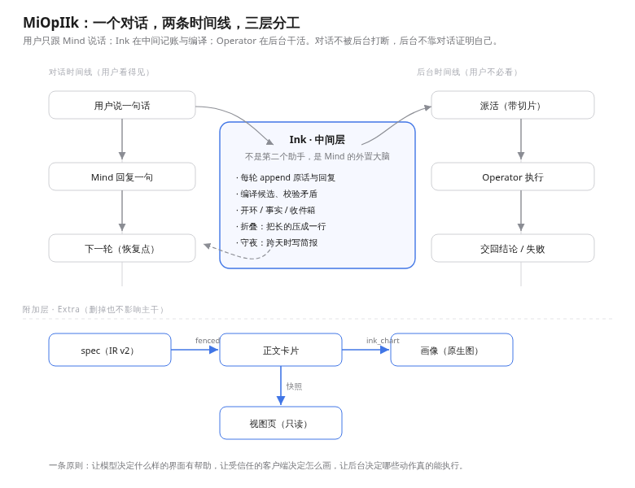
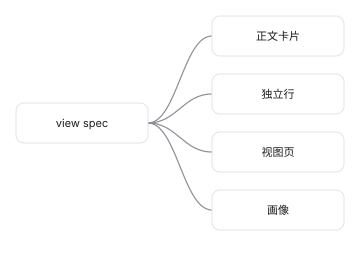
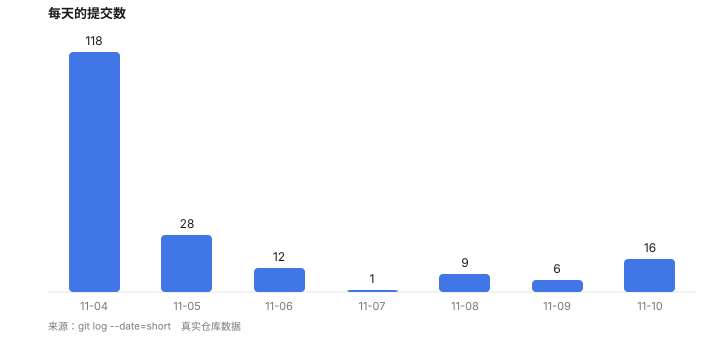
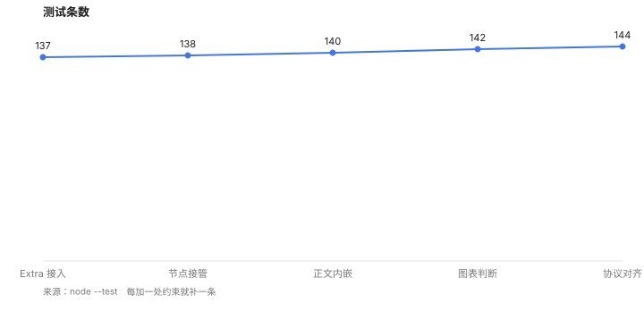
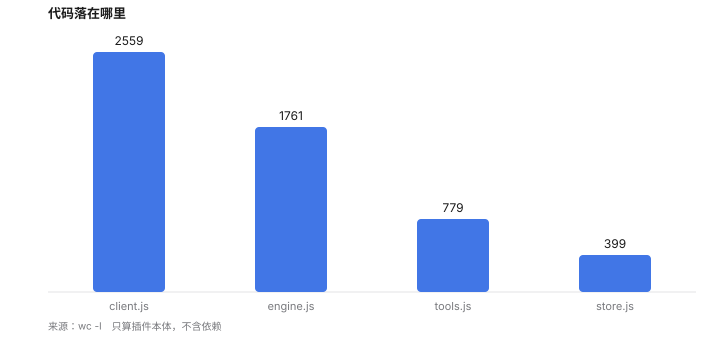

# MiOpIIk 技术与理念报告

**日期：** 2026-11-10 · **对象：** MiOpIIk（DSH 插件本体）· **口径：** 报告内数据均取自本仓库实测记录

---

## 0. 核心结构

**用户只与 Mind 交谈；Ink 在中间层负责记账、编译与守夜；Operator 在后台执行具体任务。前台对话与后台执行按各自的时间线推进，由账本对齐状态。**

---

## 1. 背景与问题

常规单回路「AI 助手 + 工具调用」存在两个结构局限：

1. **长耗时任务缺少独立叙事位置。** 派出的长任务要么阻塞当前回合等待完成，要么放到后台后脱离对话上下文。
2. **多角色直接发言导致主线混乱。** 若允许中间协调层直接向用户输出消息，容易与主对话产生重复、抢话或未经核实的结论。

MiOpIIk 将职责拆分为三层，并将面向用户的发言权限定在单一角色：

- **Mind（对话主干）**：唯一面向用户的角色，负责讨论、判断、闭合开环与发起对外提交确认。
- **Ink（中间层）**：不面向用户发言。每轮记录用户输入与助手最终回复、编译候选结论、维护开环与事实账本、管理分层收件箱，并在跨天时提供交接素材。它作为 Mind 的**外置大脑**运行。
- **Operator（后台执行层）**：仅接收六要素契约与鱼骨分支切片，完成后通过 `ink_report` 交回结论或失败原因。

系统内同时运行两条时间线：前台对话时间线由 turn 序列组成，后台执行时间线由 job 序列组成，Ink 负责将两侧状态同步到工作区账本。

---

## 2. 三条关键设计选择

| 选择 | 内容 | 权衡与代价 |
|---|---|---|
| 中间层不发言 | Ink 的所有产物先写入账本与收件箱，再由 Mind 决定何时、以何种措辞向用户提及 | 用户看到的是经整理后的结论，后台中间过程需打开面板查看 |
| 后台显式交回 | Operator 的成功结论与失败原因均通过结构化通道回传 | 需配合守夜机制（无进展与超时巡检）及 T0 阻塞预览兜底 |
| 展示层解耦 | 展示层可独立拆分或移除，核心三层机制不依赖特定 UI 协议 | 展示协议不进入核心不变式 |

---

## 3. 记忆与治理：append-only 账本

所有状态均以 append-only JSONL 存储在工作区下：

| 账本 | 内容 | 写入方 | 读取方 |
|---|---|---|---|
| `ink-context.jsonl` | 每轮原话、最终回复、决定与交回事实（尾部 24 条，超出后折叠为 2000 字头部摘要） | Ink | 编译、所见面板 |
| `facts.jsonl` | 已确认的结论（含出处、置信度与作用域） | Mind（经 `ink_facts`）、Operator（经 `ink_report`） | 每轮 L3、自答校验 |
| `loops.jsonl` | 悬而未决的开环事项 | Mind、用户干预命令 | 每轮 L3、收件箱关联 |
| `inbox.jsonl` | 待处理的分层预览 | Ink | 每轮 L3、所见面板 |
| `jobs.jsonl` / `taskboard` | 后台派发契约、子会话状态与任务卡 | Ink | Operator、所见面板 |
| `widgets.jsonl` | 历史展示 spec 快照（只读兼容） | 历史 `ink_view` | IUI legacy adapter |

**核心治理规则：开环仅由 Mind 闭合。** Ink 可在编译时标记某条开环疑似已获解答，实际 `close` / `drop` 操作由 Mind（或用户显式命令）执行。

---

## 4. 历史 Extra 展示层：一个 IR，四个落点

> 说明：本节记录 2026-11-10 时期的历史 Extra 展示层设计。该层现已退役并由独立仓库的 `miopiik-iui`（`iui/1` + `miopiik-ml`）替代；历史 `widgets.jsonl` 与 `ink-view` 数据通过 IUI 的只读 legacy adapter 兼容回放。

在当时的 Extra 设计中，一份 spec（`{widget, preset, title, props, fallback}`）对应四个落点：

1. **正文卡片**（fenced `ink-view`）：内嵌于消息流并跟随主题。
2. **独立行卡片**（`ink_view` 工具）：独立于思考过程折叠组，单轮保留最后一张。
3. **视图页**：只读快照面板。
4. **画像**（`ink_chart`）：Host 生成 SVG 落盘，正文按原生 Markdown 图片引用。

**设计边界**：采用「受限组件形状 + 预设样式 + 字段白名单 + 明确预算」，不开放模型编写任意 JSX/JS/HTML，复杂架构图通过离线 SVG/PNG 图像交付。

---

## 5. 仓库演进数据（截至 2026-11-10）

11-04 完成核心骨架搭建（单日 118 次提交），随后进入缺陷修复、实机验证与文档完善阶段。

每项结构约束均配有对应的单元测试与回归测试。

代码主要分布在宿主引擎（`host/`）与客户端面板（`client.js`）两部分。

---

## 6. 明确边界

- **单一前台角色**：中间层不对用户直接发言，所有对话输出由 Mind 统一负责。
- **日志型存储**：账本采用纯文本 append-only JSONL，按会话回放构建内存视图。
- **受控展示**：界面组件仅接受白名单结构与主题 token，不执行模型生成的脚本。
- **权限与展示分离**：界面控件不代表执行授权，对外变更统一经由 `ink_commit` 确认。

---

## 7. 阶段进展（截至 2026-11-10）

已完成并实机验证：编译线、共享任务板接入、Operator 事实交回、跨天简报、所见面板、受控展示协议与预算校验。

后续演进方向：将展示层正式拆分为独立的 `miopiik-iui` 插件包，收敛为声明式 `miopiik-ml` 与本地 `$state` 绑定（详见 `miopiik-iui` 仓库文档）。
